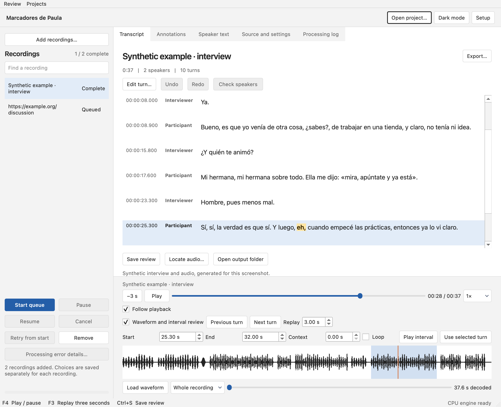
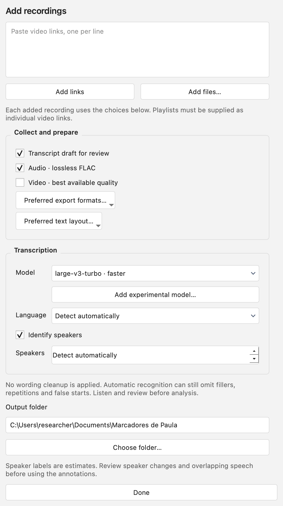
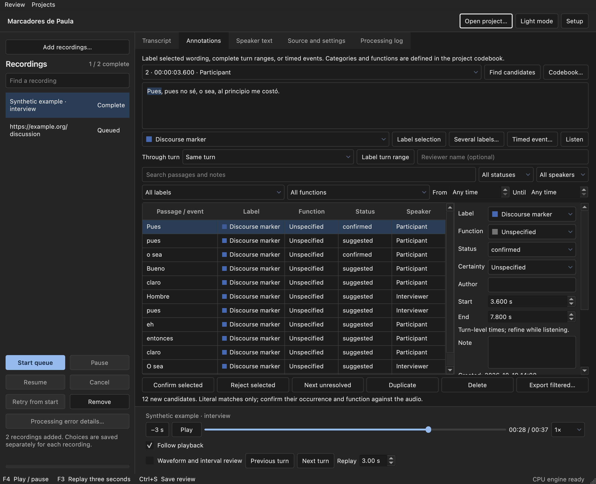

# Marcadores de Paula

[](https://doi.org/10.5281/zenodo.23482888)

Marcadores de Paula is a desktop application for turning recordings into transcripts that can be checked and annotated for research. It downloads media from a link or takes local files, transcribes them on your own computer with WhisperX, aligns each word to the audio, and separates speakers with pyannote (speaker diarization). The transcript then opens in an editor where every turn plays back against the audio, speakers and wording can be corrected, and passages can be coded with a project codebook. Results export to plain text, Word, spreadsheets, subtitles, Praat and ELAN.

It was written for research on discourse markers in spoken Spanish, so it applies no cleanup of its own to repetitions, fillers or restarts, and it keeps the unedited machine transcript beside the reviewed one.



## Installation

### Windows

Download `MarcadoresDePaula-Setup-<version>-stock.exe` from the [latest release](https://github.com/emmachados/marcadores-de-paula/releases/latest) and run it. The installer is for 64-bit Windows and installs for the current user without administrator rights. The installer is unsigned, so Windows SmartScreen may ask for confirmation; each release lists the installer's SHA-256 checksum. To update, install the new version over the old one. The queue, recording folders and reviews are kept.

### Mac

Download `MarcadoresDePaula-<version>-macOS-arm64-stock.dmg` from the [latest release](https://github.com/emmachados/marcadores-de-paula/releases/latest), open it and drag Marcadores de Paula to Applications. The application needs a Mac with Apple silicon and macOS 26 or later; there is no Intel version, because the PyTorch release the transcription engine needs has no Intel Mac build. The application is not notarized by Apple, so the first time it is opened macOS reports that Apple could not verify it is free of malware. Choose Done, open System Settings → Privacy & Security, select Open Anyway next to the message about Marcadores de Paula and confirm with your password. Later starts open normally. Each release lists the disk image's SHA-256 checksum. To update, replace the application in Applications with the new one. The queue, recording folders and reviews are kept.

## First start

Open Setup and install the processing engine: CPU, or on Windows also NVIDIA. The application downloads its own Python runtime and dependencies, so no separate Python installation or terminal is needed. The engine and the models fetched on first use take several gigabytes. No NVIDIA card is needed for CPU mode. The NVIDIA engine installs and imports correctly in the Windows build, but transcription on a GPU has not been tested.

Speaker separation uses the pyannote [speaker-diarization-community-1](https://huggingface.co/pyannote/speaker-diarization-community-1) model, which requires a free Hugging Face account. In Setup, Open model access page leads to the conditions to accept, and Create a read token to the page where the token is made. Paste the token into Setup, use Check model access to confirm that it works, and choose Save and close. The token stays in memory for the session, or in the operating system's credential store if "Remember the token" is selected. It is never written to queue files or transcript metadata. Transcription works without a token; the speaker stage is then skipped with a warning.

## Transcribing



Choose Add recordings, then paste video links (one per line) or select local audio and video files. For each batch, choose what to keep (video, lossless FLAC audio, transcript), the model, the language, whether to identify speakers and how many there are. Preferred export formats… and Preferred text layout… set where the Export dialog starts for those recordings; the layout covers timestamps, grouping by speaker and paragraph breaks in TXT and DOCX.

The default model is large-v3-turbo, a version of Whisper large-v3 whose decoder has 4 layers in place of 32, so it runs faster; the full large-v3 is the other choice. Both can detect the language automatically. The speaker count is detected automatically unless you set it; setting it to 1 skips the speaker model altogether. Start queue processes recordings one after another, and a failed recording does not stop the rest.

Pause stops the current recording and leaves the others waiting. Resume continues it, also after the application has been closed. Completed stages (media preparation, recognition, alignment, speaker assignment) are saved in the recording's folder and are not repeated; the interrupted stage starts again from its beginning. Retry from start makes a fresh attempt in a new folder and keeps the old one. Cancel stops the current recording and the queue, keeping completed media files and any partial transcript. Remove takes a recording off the list without deleting its files.

If word alignment or the speaker stage fails, the transcript is kept and the recording is marked Complete with warnings. Resume retries only the stage that failed. [Troubleshooting](docs/troubleshooting.md) covers the common failures.

<br clear="right">

## Reviewing

Select a completed recording to open it.

- Playback runs from 0.5× to 2× speed. F4 plays and pauses, F3 replays the last three seconds (adjustable under Replay), and clicking a timestamp seeks to it. Aligned words are highlighted as they are spoken.
- Double-click text to edit it. Double-click a speaker name to reassign that turn; typing an existing name joins that speaker, and a new name creates one. Review → Manage speakers… renames a speaker throughout the recording.
- Edit turn… splits a turn at the cursor and a chosen audio time, merges it with the next turn, or corrects its start and end times.
- Check speakers steps through turns whose speaker assignment is missing or ambiguous.
- The Speaker text tab shows each speaker's turns as continuous text, with or without timestamps. Find and replace… (Ctrl+F) previews every change before applying it.
- In the waveform view, drag to select an interval and play it, optionally looped and with a chosen amount of context before and after.

Undo and Redo (Ctrl+Z, Ctrl+Shift+Z) cover the last 20 review changes. The review saves itself two seconds after each change, including text still being typed, and again when you switch recordings or close the window. Named snapshots and automatic revisions can be restored from the Review menu.

Open project… (Ctrl+Shift+O, also in the Projects menu) reopens a saved recording folder, for example one copied from another computer, without transcribing it again. Review → Create portable project… packs a review, its history and optionally its media into a single `.paula.zip` file.

The [review workspace guide](docs/review-workspace.md) describes these tools in full.

## Annotating

The Annotations tab is a separate layer over the transcript and never changes its text. Select a passage, choose a label and use Label selection. A passage can carry several labels, a record can span several turns, and a timed event can mark a stretch of audio, such as laughter or background noise, without adding transcript text. Each record has a status, a certainty rating, an optional discourse function, notes and links to related records.

Labels and functions come from a codebook stored with the project. It starts with 27 labels (discourse markers, repetitions, restarts, filled pauses, overlaps, laughter, lengthening, unintelligible speech and others) and 21 functions, and every entry can be renamed, archived, grouped or given a shortcut. Codebooks can be exported and imported between projects. The labels draw on the Val.Es.Co. transcription conventions but cover only part of them.

Find candidates lists literal occurrences of common Spanish marker forms and adjacent repeated words. Every candidate starts as suggested, with no function. Whether a given *pues* works as a marker can only be decided by listening, so each candidate has to be confirmed or rejected. If the wording under an annotation is edited later, the annotation is marked for review.



## Output

Each recording gets its own folder under the chosen output location (by default `Marcadores de Paula` in the Documents folder). `source.json` records the source, the settings, the input's SHA-256 and the versions of the processing libraries. `asr-original.json` keeps the recogniser's output before alignment, `result.json` the aligned draft, and `reviewed.json` and `autosave.json` your review, from Save review and from automatic saves; the newer of the two is opened. Export… writes the chosen formats to a new timestamped folder each time, so earlier exports are never overwritten.

| Format | Content |
| --- | --- |
| TXT | Speaker-labelled text with start and end times |
| DOCX | Paragraphs with speaker and timestamp headings, optionally with annotations highlighted |
| CSV | One row per turn: start, end, speaker and text (UTF-8 with BOM) |
| JSON | Transcript, word timings, speaker intervals, annotations and processing metadata |
| SRT, VTT | Subtitles, one cue per turn |
| TextGrid | Praat, one interval tier per speaker, optional annotation tiers |
| EAF | ELAN, one tier per speaker, linked to the retained media, optional annotation tiers |

Annotated recordings also export `annotations.csv` and `annotations.json`. With "Concordance and count tables" selected in Export…, the export adds `concordance.csv` (one row per annotated span), `annotation-counts.csv`, `speaker-summary.csv` and `counting-rules.json`. Filter on `status=confirmed` to keep only reviewed annotations. Character offsets count Unicode code points.

A Praat interval tier cannot hold two overlapping intervals, so TextGrid export refuses a speaker tier with overlapping turns; EAF and JSON keep those timings. CSV cells that a spreadsheet could read as formulas get a leading apostrophe.

## Accuracy of the transcript

Whisper can drop disfluencies, substitute words and add punctuation of its own, and dropped material cannot be recovered from its output, so counts of markers or repetitions need checking against the audio. Both Whisper models behave this way. The application applies no text normalisation or prompt of its own, and it sets the decoder's repetition controls to neutral values (`repetition_penalty=1.0`, `no_repeat_ngram_size=0`), which are recorded in each result's metadata.

Edited passages keep their original word timings in the JSON record, and playback highlighting for them falls back to the whole turn. Manual boundary changes do not trigger a new forced alignment.

## Privacy

Recognition, alignment, speaker separation and review all run on your computer. The application connects to the internet to download media from links, and to fetch packages and models during setup and first use. It does not send transcripts, corrections or annotations anywhere. Recording folders contain source links, local paths and the transcripts themselves, so a shared output folder can identify the people recorded.

## Where files are stored

The queue lives in the application-data folder, `%APPDATA%\TranscriptDesk\Transcript Desk` on Windows. The engine, Python, model caches and setup logs live in `%LOCALAPPDATA%\TranscriptDesk\Transcript Desk`. On a Mac both are in `~/Library/Application Support/TranscriptDesk/Transcript Desk`. Uninstalling the application removes neither of them, nor any recording folder.

When the application version changes, a safety copy of the queue, transcripts, reviews and revision history is written to `preservation-backups` in the application-data folder before the queue opens. Projects → Back up work… makes the same kind of copy wherever you choose, and Projects → Import previous work… restores one. These copies do not include media, models or processing checkpoints. To move a project with its audio, copy the whole recording folder or use a portable project.

Two environment variables move these folders: `TRANSCRIPT_DESK_DATA` moves both, and `TRANSCRIPT_DESK_RUNTIME` moves only the engine and caches. Only one window can use a given data folder at a time.

## Limitations

- Links must point to individual public videos. Playlists, sign-in and browser cookies are not supported, and a site can change in ways that break extraction.
- TikTok links were tested on 20 October 2026 with public video posts. For TikTok the application takes the audio from the video file, because the separate audio track TikTok offers is the sound attached to the post, which can be a song in place of the clip's own audio. Photo posts have not been tested.
- GPU transcription has not been tested, and minimum memory requirements have not been measured. Processing time has been measured on one computer, a MacBook Pro with an Apple M5 Pro and 48 GB of memory, using the CPU engine on mains power: a one-hour excerpt of a Spanish podcast with four speakers took 42 minutes with large-v3-turbo and 53 minutes with large-v3, of which speaker separation took 29 and 28 minutes, and the processing worker used under 5 GB of memory.
- Subtitle cues are whole turns, so long turns may need splitting in a subtitle editor.
- The interface is in English.

## Running from source

Python 3.11, [uv](https://docs.astral.sh/uv/), FFmpeg (with `ffmpeg` and `ffprobe` on `PATH`) and Deno, which current yt-dlp needs for YouTube, are required:

```sh
uv venv --python 3.11
uv pip install -e '.[dev]'
.venv/bin/python run_app.py
```

On Windows, run `.venv\Scripts\python.exe run_app.py`. The engine is installed from Setup as in the packaged application. Run the tests with `QT_QPA_PLATFORM=offscreen .venv/bin/python -m pytest -q`, or in PowerShell set `$env:QT_QPA_PLATFORM = "offscreen"` and run `.venv\Scripts\python.exe -m pytest -q`. [Building](docs/building.md) covers the installers, the dependency locks and the verification that runs on every build.

## Documentation

- [Review workspace](docs/review-workspace.md): speaker text, find and replace, codebooks, waveform review, export options, saving and recovery
- [Processing errors and retained transcripts](docs/processing-errors.md)
- [Troubleshooting](docs/troubleshooting.md)
- [Building](docs/building.md)
- [Changelog](CHANGELOG.md)
- [Third-party components](THIRD_PARTY.md)

## Reporting problems

Report problems through [GitHub issues](https://github.com/emmachados/marcadores-de-paula/issues). Include the text from Copy details or Copy installation log, and the archive from Projects → Export diagnostic logs…; [Troubleshooting](docs/troubleshooting.md#diagnostics) describes what these contain.

## Citation and licence

If you use Marcadores de Paula in research, please cite it; [CITATION.cff](CITATION.cff) has the details, and GitHub's "Cite this repository" button formats them. Zenodo archives every release. The DOI [10.5281/zenodo.23482888](https://doi.org/10.5281/zenodo.23482888) covers all versions and resolves to the latest; version 0.9.1 is [10.5281/zenodo.23641717](https://doi.org/10.5281/zenodo.23641717) and version 0.9.0 is [10.5281/zenodo.23482889](https://doi.org/10.5281/zenodo.23482889).

The source code is licensed under the [GNU General Public License, version 3 or later](LICENSE). Bundled and downloaded components keep their own licences, listed in [THIRD_PARTY.md](THIRD_PARTY.md). The speaker model's licence and access conditions are set by its authors on Hugging Face.
